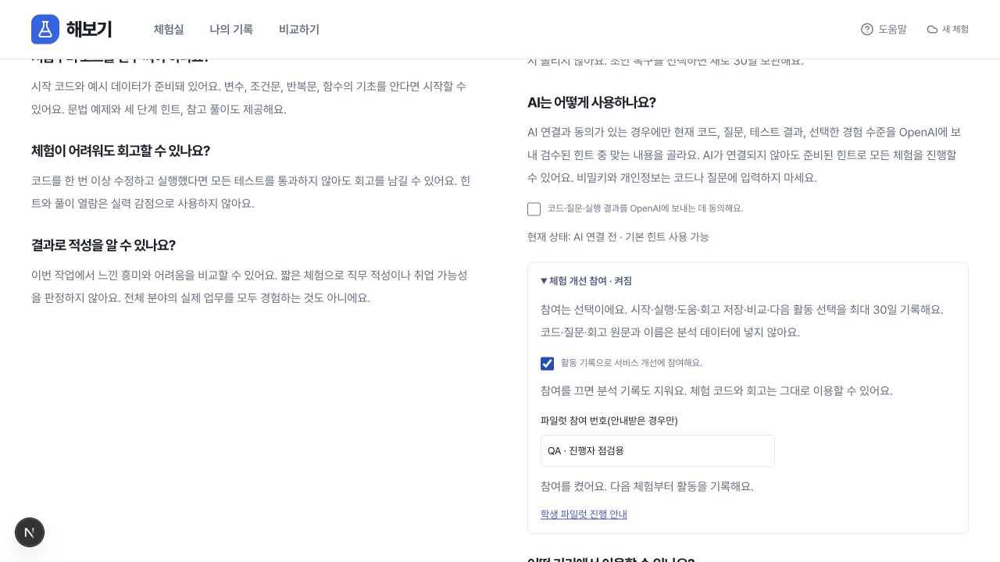

# 선택 참여 분석

이슈 #2 P1-5. 외부 분석 SDK 없이 기존 앱과 Neon으로 필요한 활동 요약만 수집합니다. 학생 파일럿 성과나 적성을 판정하는 기능은 아닙니다.

## 동의와 보관

- 기본값은 꺼짐입니다. 도움말 또는 게임의 ‘체험 개선 참여’에서 선택합니다. AI 전송 동의와 별개이고 비동의 상태에서도 체험·저장·기본 힌트를 이용합니다.
- 서버가 동의를 확인하기 전에는 분석 세션·여정 ID를 만들거나 이벤트를 전송하지 않습니다. 기존 학습 기록용 HttpOnly 쿠키는 별도입니다.
- 서버가 발급한 동의 기간 토큰이 일치해야 저장합니다. 참여 번호 변경·다시 동의는 새 기간을 시작하고 이전 기간 이벤트를 지웁니다. 참여 번호는 동의 전에 선택합니다. QA는 진행자 점검용이며 기본 집계에서 제외합니다.
- 끄면 이 브라우저의 분석 이벤트를 삭제하고 다음 수집을 멈춥니다. 실패하면 기기에는 중단 선택을 남기고 재시도하게 합니다. 다음 접속에서 임의로 다시 켜지 않습니다. 학습 코드·회고는 유지합니다.
- 전체 기록 삭제는 분석 이벤트도 삭제하며, 과거 쿠키로 늦게 도착한 전송·동의 복구를 차단합니다. 동의 행 잠금과 기간 토큰으로 철회 중인 요청이 이벤트를 되살리지 않게 합니다.
- 동의는 선택 후 30일간 유효하고 조회만으로 연장하지 않습니다. 이벤트는 서버 수신 후 30일, 설정·삭제 차단 표시는 마지막 변경 후 30일을 기준으로 일일 정리합니다. 정확한 시각의 물리 삭제를 보장하는 SLA는 아닙니다.

## 이벤트 계약 v1

모든 이벤트는 UUID 이벤트 ID·세션 ID와 버전 1을 가집니다. 체험 이벤트에는 여정 ID, 코드/게임 구분, 직무, 콘텐츠 버전이 추가됩니다. 코드 버전은 실제 검수 콘텐츠에 있어야 하며 게임은 `games-2026-11-23.1`로 구분합니다. 소유자·참여 번호·수신 시각은 서버가 지정합니다.

| 이름                    | 추가 요약과 의미                                                                                                                   |
| ----------------------- | ---------------------------------------------------------------------------------------------------------------------------------- |
| `page_view`             | home/work/journal/compare/guide/games 중 하나. URL·검색어는 수집하지 않음                                                          |
| `mission_start`         | new/resume. 화면을 다시 열면 새 여정이며 이어하기를 구분                                                                           |
| `run_result`            | 실행 ID, edited/starter/reference/unverified, 통과·전체 개수, checks/error. 실행 원문·입출력은 없음                                |
| `help_open`             | primer/basic_hint/reference/line_locator/ai_request 중 하나                                                                        |
| `ai_result`             | ai/guide/none 출처와 received/failed/canceled. 질문·모델 설명은 없음                                                               |
| `reflection_submit`     | 회고 제출을 눌렀을 때 실행 ID. 저장 성공과 구분                                                                                    |
| `reflection_saved`      | 정확히 해당 회고 스냅샷의 서버 저장 응답을 확인한 뒤 실행 ID                                                                       |
| `next_action_selected`  | 다음 활동 유형과 대상 직무. 선택 이유는 없음                                                                                       |
| `next_action_committed` | 회고 저장 응답 후 유형·대상·실행 ID                                                                                                |
| `mission_end`           | left/submitted/completed. completed는 게임만, submitted는 코드만. 체류 시간은 최대 1시간이며 실력·능동 작업 시간으로 해석하지 않음 |
| `comparison_view`       | 확인된 코드 완료 직무 개수                                                                                                         |
| `game_check`            | 게임 확인 버튼의 성공/실패. 코드 실행과 별개                                                                                       |

Zod의 엄격한 허용 목록으로 알 수 없는 필드를 거절합니다. 코드·질문·회고·선택 이유·이름·이메일·URL·사용자 에이전트 원문을 분석 테이블에 복제하지 않습니다. 학습 저장과 AI 전송의 기존 범위는 각 기능의 정책을 따릅니다.

## 전송과 API

`/api/analytics`: GET 설정 확인, PUT 명시적 참여 설정, DELETE 철회, POST 이벤트 배치입니다. 쓰기는 같은 출처 JSON 요청만 받습니다. 공개 원본 조회·관리자 내보내기 API는 없습니다.

- 1회 최대 20개·본문 16,000자. 클라이언트는 메모리에 최대 60개, 600ms 단위 배치와 응답 본문 포함 3초 제한을 사용합니다.
- 영속 재전송 큐는 없습니다. 연결 실패·탭 종료·메모리 초과로 누락될 수 있으며 체험 저장을 막지 않습니다. 화면 전환 시 종료 전송도 최선의 시도입니다.
- 이벤트 ID 중복은 한 번만 저장합니다. UTC 하루 제출량은 브라우저 소유자당 500개·전체 10,000개로 제한합니다. 중복·거절 제출도 한도를 소비할 수 있습니다. AI 한도와 별도이며 결제 예산이 아닙니다.
- 세션은 탭 저장소에서 30분 비활동 후 갱신합니다. 브라우저·기기 간 학생 식별이나 실명 확인은 하지 않습니다. 다중 탭 철회는 기기 저장소 알림으로 전달하며 저장소 차단 환경에서는 전달을 보장하지 않습니다.

## 집계

서버 접근 권한이 있는 운영자만 로컬에서 실행합니다. `.env.local`은 Git에서 제외합니다.

```sh
node scripts/report-analytics.mjs --since 2026-11-23 --until 2026-11-24 --cohort pilot > /private/path/report.json
node scripts/report-analytics.mjs --input /private/path/synthetic-events.json --cohort all
```

날짜는 UTC, `until`은 제외 경계입니다. 기본 범위는 최근 30일 시작일~내일 0시이며 all/pilot/prepilot/general을 구분합니다. 기본 `all`은 일반 이용과 정식 P01~P12이며 S01~S03 예비테스트는 제외합니다. `prepilot`만 S번호를 집계하며 `quality.prepilotExcluded`로 제외 수를 표시합니다. QA는 `--include-qa`를 명시해야 포함되고 pilot/prepilot 분모에는 포함하지 않습니다. 50,000개를 초과하면 부분 보고서를 만들지 않고 기간 축소를 요청합니다. 출력에는 소유자 키·동의 토큰·세션·여정 ID를 넣지 않습니다.

- `perRole`은 코드/게임·직무·콘텐츠 버전별입니다. 시작(이어하기 포함), 수정 실행, 도움, 제출/저장, 저장이 관측되지 않은 제출, 다음 활동, 게임 확인/실패/완료를 구분합니다.
- 저장된 코드 회고는 같은 브라우저·직무·버전·실행 ID의 수정 실행 보고가 있어야 셉니다. 이어하기 전의 실행도 연결합니다. 게임 완료는 성공 확인과 완료 종료가 함께 있어야 셉니다. 모두 브라우저의 미검증 보고이며 서버가 학생 코드를 실행한 증거가 아닙니다.
- 첫 체험 종료율의 분모는 기간 내 첫 ‘새 코드 체험’이 관측된 브라우저 수, 분자는 그 첫 직무·버전의 회고 저장이 관측된 수입니다. 같은 직무·버전의 이후 이어하기도 연결합니다. 이어하기만 있는 브라우저는 이 분모에서 제외합니다.
- 두 직무+다음 활동도 같은 분모 중 서로 다른 코드 직무 두 개와 저장된 활동이 관측된 수입니다. 비교 완료 화면을 본 세션은 별도입니다. 회고에서 먼저 활동을 고를 수 있어 ‘비교→선택’ 순차 전환으로 표현하지 않습니다.
- 비율마다 분자·분모를 출력하고 n=0은 null입니다. 같은 참여 번호의 여러 브라우저, 중복, 시작 누락, 문맥 불일치, 실행과 연결되지 않은 회고는 품질 수로 표시합니다. 실제 참여자 수는 진행자 양식으로 확인합니다.
- 명시적 나감과 끝 이벤트 누락을 구분합니다. 저장 알림의 메모리 연결이 새로고침으로 사라지거나 전송이 누락될 수 있으므로 저장 미관측·종료 누락을 실제 실패·이탈로 단정하지 않습니다. 조회 기간 경계도 분모에 영향을 줍니다.
- 명확성 변화·선택 이유 설명·7일 후 실제 시작은 자동 이벤트로 추정하지 않고 [파일럿 양식](PILOT.md)으로 확인합니다. 소수 학생의 선택 동의 자료를 전체 학생이나 적성의 결과로 일반화하지 않습니다.

## 운영 준비와 검증

`002_analytics.sql`은 기존 체험 데이터 변경 없이 테이블 세 개를 추가합니다. 새 코드 배포 전에 `npm run db:migrate`가 필요합니다. 이번 작업에서 연결된 Neon의 추가 마이그레이션을 완료했으며 main 병합·배포는 별도입니다. 새 환경도 001부터 순서대로 적용합니다. 새 비밀키나 외부 분석 서비스는 필요하지 않습니다.

테스트는 동의·엄격한 계약·중복·철회·재동의·전체 삭제·30일 정리·한도·집계 분모·이어하기·저장 응답 연결을 포함합니다. 별도 SQLite 서버 API와 브라우저에서 동의 전 0건, 원문 비포함, 저장된 회고/활동 각 1건, 코드/게임 분리와 QA 기본 제외를 확인했습니다. 실제 Neon에서는 임시 QA 자료로 전송 중 철회 뒤 늦은 이벤트가 남지 않는 경합을 확인하고 임시 자료를 제거했습니다. AI 실호출이나 실제 학생 실험은 이번 검증에 포함하지 않았습니다.

```sh
npm test
npm run build
npm run typecheck
LAB_TEST_URL=http://127.0.0.1:3003 node tests/analytics-api.mjs
```



3명 예비테스트의 S번호·진행 대본·빈 양식은 [예비테스트 준비](PREPILOT.md)를 참고하세요. 정식 12명과 예비테스트의 응답·성과를 합치지 않습니다. `node scripts/report-analytics.mjs --help`는 DB나 비밀 설정 없이 집계 범위를 확인합니다.
