# 디자인 개편 검토

2026-11-23. 기존 서비스 화면을 직접 캡처하고 레퍼런스·코드 검토 후 구현했습니다. 기록·점수·실행은 별도 SQLite 미리보기의 합성 QA 자료이며 학생 응답이나 운영 사용자 자료가 아닙니다. 최초 디자인은 PR #38·#39로 반영했고 아래에는 후속 통합 검토를 덧붙였습니다.

## 처음 확인한 문제

1. 홈: 큰 미니 화면, 정적 ‘오늘의 다른 선택’, 소개·개념·업무 이름이 함께 보여 선택의 위계가 약했습니다. [이전 홈](screenshots/redesign/before-home.jpg)
2. 실습: 보조 글자와 동의 문구가 작고 코드·코치가 비슷하게 강조됐습니다. AI 질문의 펼침 동작도 드러나지 않았습니다. [이전 실습](screenshots/redesign/before-work.jpg)
3. 게임: 같은 테두리 카드와 시작 문구가 반복됐고 분석 설정이 첫 행동보다 앞에 있었습니다. [이전 게임](screenshots/redesign/before-games.jpg)

기존 실습 캡처는 이전 버전 이어하기, 새 캡처는 현재 버전 체험입니다. 과제 시간·코드 길이의 차이를 이번 디자인 변경의 효과로 해석하지 않습니다. 동결 콘텐츠·게임 규칙·AI 근거·분석 계약은 수정하지 않았습니다.

## 화면별 확인

| 순서 | 화면과 상태        | 확인 결과                                                                                                                                                    |
| ---- | ------------------ | ------------------------------------------------------------------------------------------------------------------------------------------------------------ |
| 1    | 홈·분야 선택       | 업무·직무·시간·상태 중심으로 정리. 실제 필터에서 AI/데이터 두 카드와 전체 여섯 카드 확인. 완료/이어하기 문구 구분                                            |
| 2    | 코드 체험          | 프론트엔드·백엔드를 각각 수정하고 실행해 5/5 확인. 조건·코드·코치를 함께 읽고 실행 버튼을 찾을 수 있음. 1280px에서 예시 긴 코드 줄이 편집기 너비 안에 표시됨 |
| 3    | AI 도움            | 질문 펼침 라벨·화살표·동의·입력·기본 힌트 표시 보존. 외부 AI 실호출은 이번 디자인 검사 범위가 아님                                                           |
| 4    | 회고               | 점수→회고→활동→이유의 부족한 입력에 따라 안내가 바뀜. 기존 필수 조건 입력 후 제출 가능. 대화상자 초점 이동 유지                                              |
| 5    | 나의 기록          | 실행 근거·회고·활동·이유·서버 저장 상태·기한·내려받기·삭제 안내 보존. QA 회고 두 개 확인                                                                     |
| 6    | 비교               | 두 직무 점수·회고·활동이 저장 값과 일치. 직무별 최소 열 너비와 키보드 초점 가능한 스크롤 영역 제공. 모바일 실제 다직무 표의 전체 조작 검사는 별도로 남음     |
| 7    | 게임               | 목록·상황판·조작·완료 위계 통일. 첫 게임 실패 안내→수정→완료를 실제 조작해 확인. 다른 다섯 게임의 규칙은 기존 자동 검사 범위                                 |
| 8    | 도움말·설정·파일럿 | 직접적인 제목과 본문, 동의 확인 중·번호 선택·철회 설명 보존. 12명 배정·동일 질문·빈 양식 링크 유지                                                           |
| 9    | 390px 모바일       | 홈·실습·도움말·게임 목록을 Chrome 반응형 화면에서 확인. 페이지 너비 390px·전체 가로 넘침 없음. 편집기 내부 가로 스크롤 너비와 도움말 접근 확인               |

인앱 브라우저의 화면 크기 변경이 실제 뷰포트에 적용되지 않아 모바일 검사는 Chrome으로 진행했습니다. 모바일 캡처는 실제 390×844 뷰포트 영역을 그대로 저장했습니다. 잘못 축소된 중간 캡처는 결과로 사용하지 않았고 임시 화면 크기는 검사 후 해제했습니다.

## 자동·API 검증

- 기존 테스트 154/154 통과. UI 모양을 복제하는 테스트는 추가하지 않았습니다.
- `npm run build`, `npm run typecheck`, `git diff --check` 통과.
- 별도 SQLite 미리보기에서 analytics/api-smoke 검사 통과: 동의·원문 제외 계약·중복·철회·삭제 차단, 저장·사용자 분리·버전·삭제·기본 힌트 보존.
- 주요 글자/배경·파란 버튼/흰 글자 대비를 계산하고 연한 보조 글자를 조정했습니다. 모든 예외 상태·스크린리더 조합을 검사한 접근성 인증은 아닙니다.
- Pretendard 실제 로드 확인. 기존 동결 콘텐츠·추천 규칙 파일은 변경하지 않았습니다.

## 최종 화면

### 저장·파일럿·예산 통합 후 추가 검토

프론트엔드와 디자이너가 PRD 문제 및 기술 30·창의성 25·실용성 25·발표/협업 20의 기준으로 병렬 검토했습니다. 업무명·행동 라벨이 주된 안내이고 직무 아이콘은 보조 역할입니다. 실제 근거가 없는 적성 판정이나 자동 진로 결정을 안내하지 않습니다.

- 홈: 교내 행사라는 맥락, 업무→흥미/어려움→다음 학습, JavaScript 기초와 게임 입구를 표시합니다. 데스크톱 첫 세 카드와 390px 첫 카드 CTA·4개 필터에 잘림이 없었습니다.
- 회고: 문법이 낯선 것과 업무 흥미를 따로 생각하도록 안내합니다. 390px의 다섯 선택지, 양끝 척도, 안내와 입력·제출 동작을 확인했습니다.
- 실제 모바일 흐름: 백엔드 `>`→`>=` 수정, 5/5 실행, 세 점수·합성 회고·활동·이유 입력, 서버 저장, 활동 안내 링크까지 조작했습니다. 활동 안내와 기존 코드 체험 CTA를 구분합니다.
- 게임: 완료·4점 흥미를 저장한 뒤 새로고침해 복원하고 비교에서 코드 완료와 분리되는 것을 확인했습니다.
- 통합 단위 199개, 빌드·타입, 저장·동시성·다음 활동·분석·기록 관리의 별도 API 검사 통과. 시각 검토에서 출시 차단 문제를 발견하지 못했으나 전체 접근성 인증을 뜻하지 않습니다.

실용성의 남은 근거는 학생 3명이 스스로 첫 수정 위치를 찾고, 도움 후 다음 행동을 설명하며, 업무 차이와 다음 학습을 자기 말로 고르는지 관찰하는 일입니다. 담당자는 전원 미정이며 역할 배정과 실제 2분 리허설도 남아 있습니다. PRD v0.2의 AI 코드 검수·지시 모드를 구현 완료로 소개하지 않습니다.

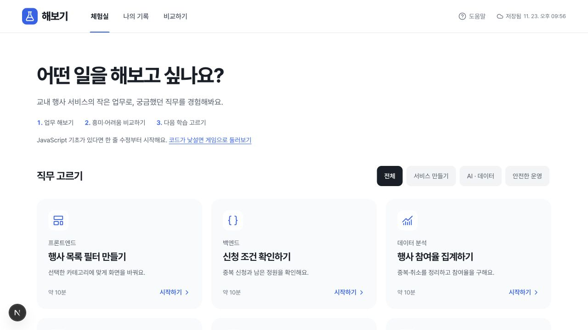

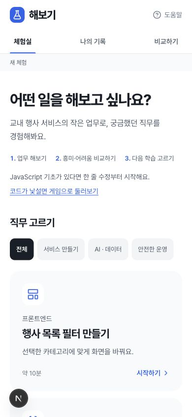

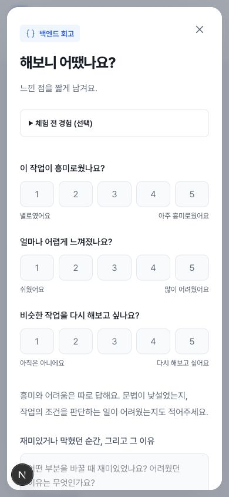

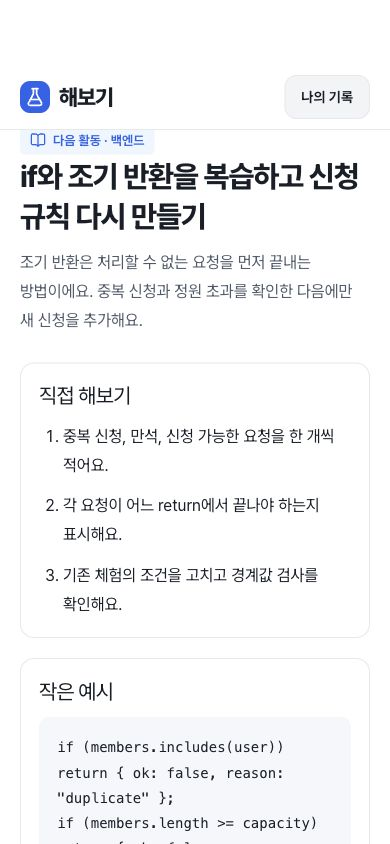

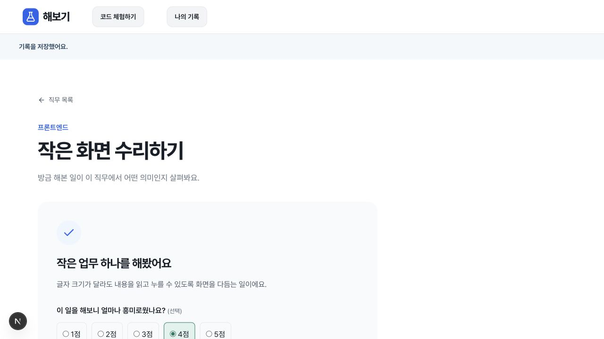

### 앞선 디자인 개편 캡처

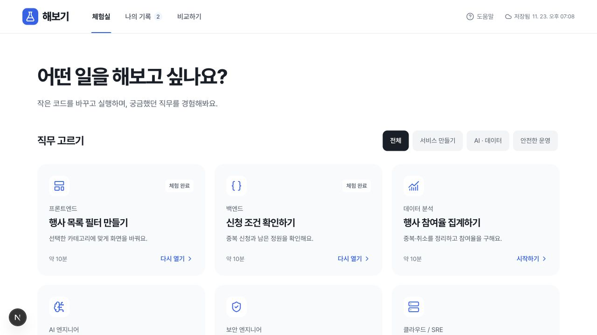

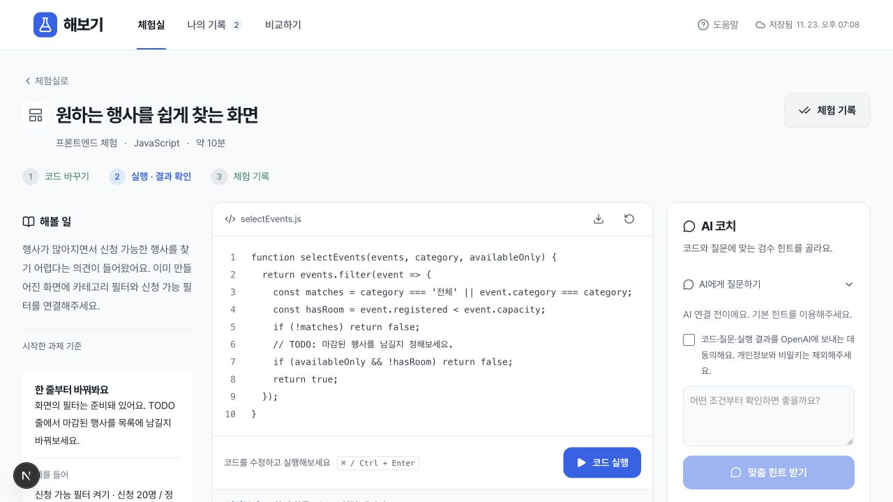

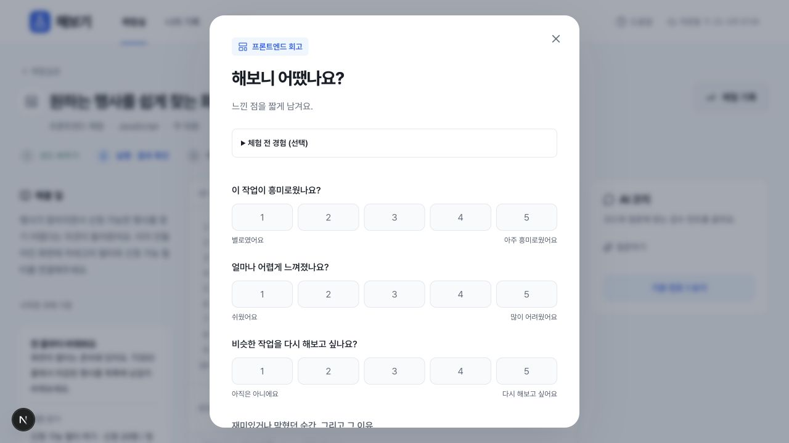

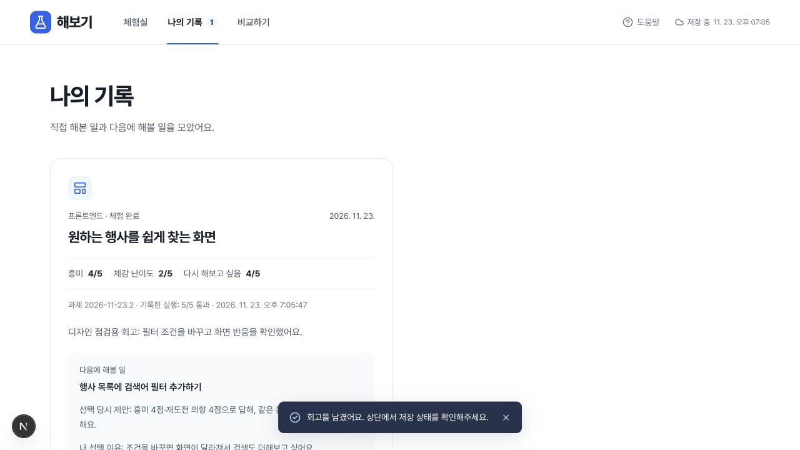

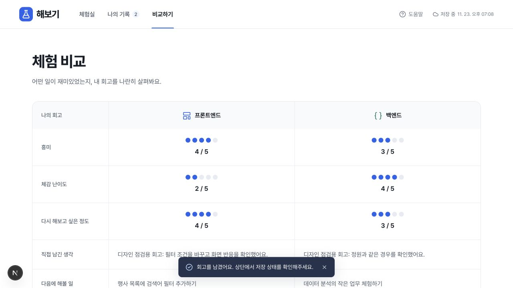

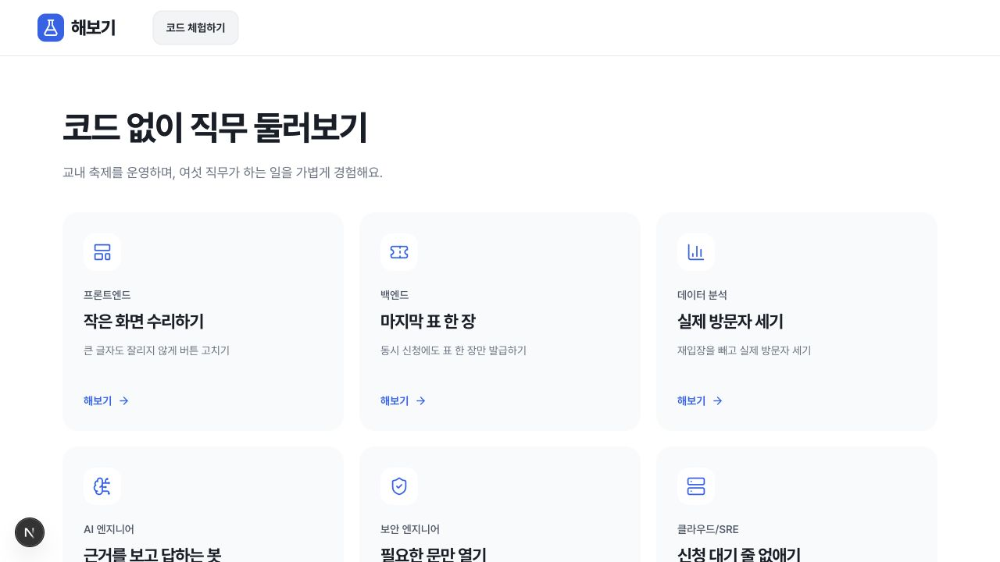

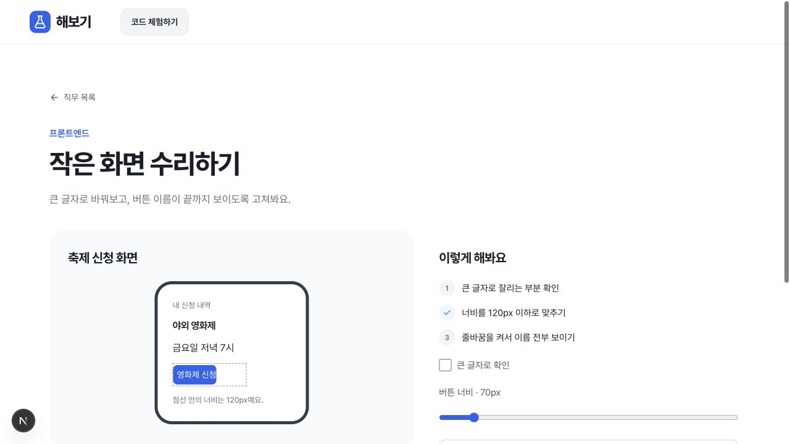

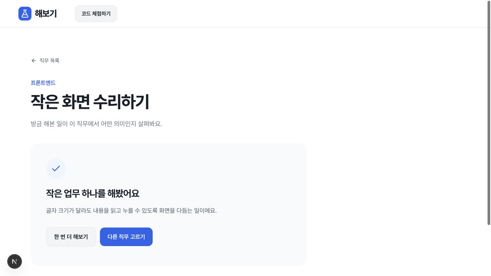

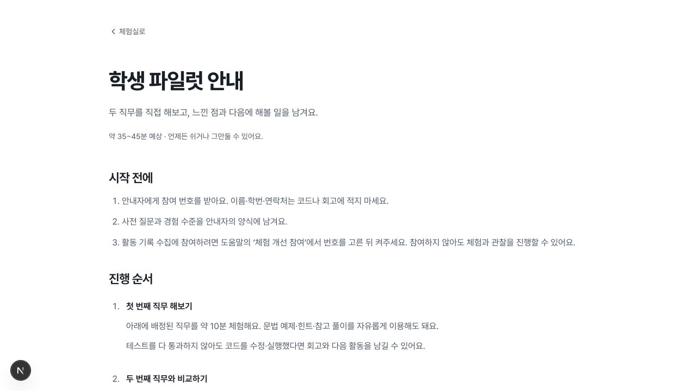

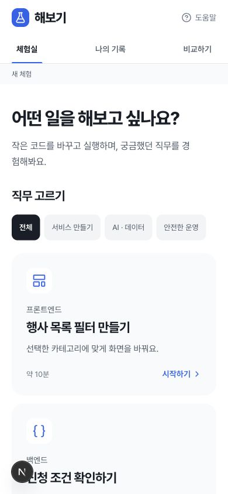

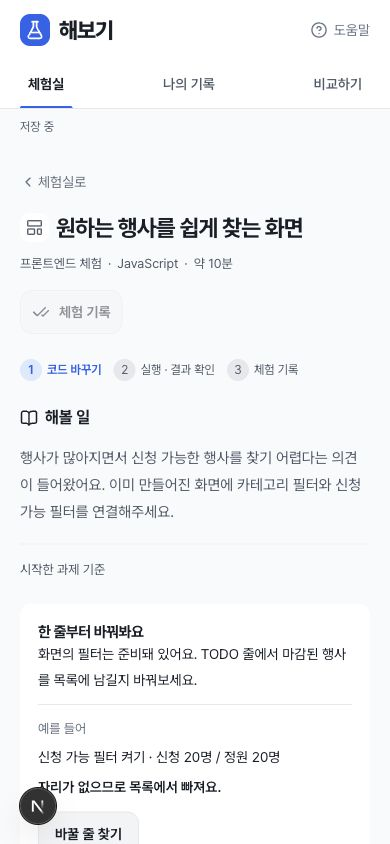

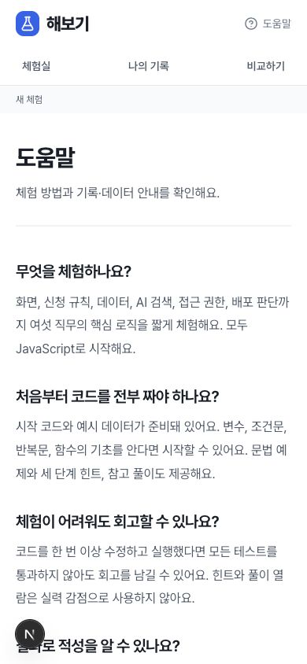

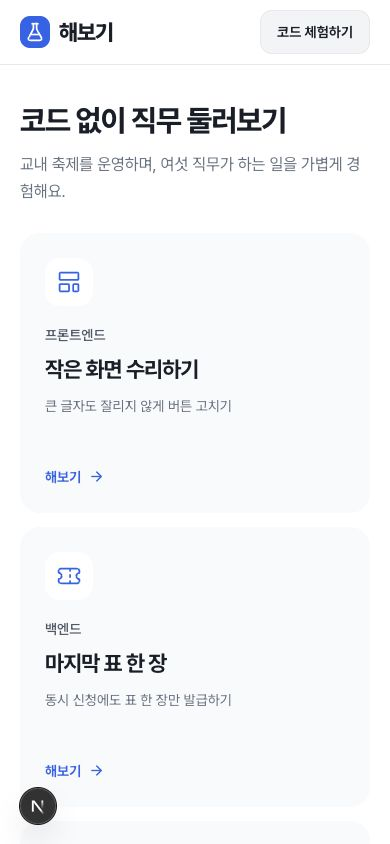
