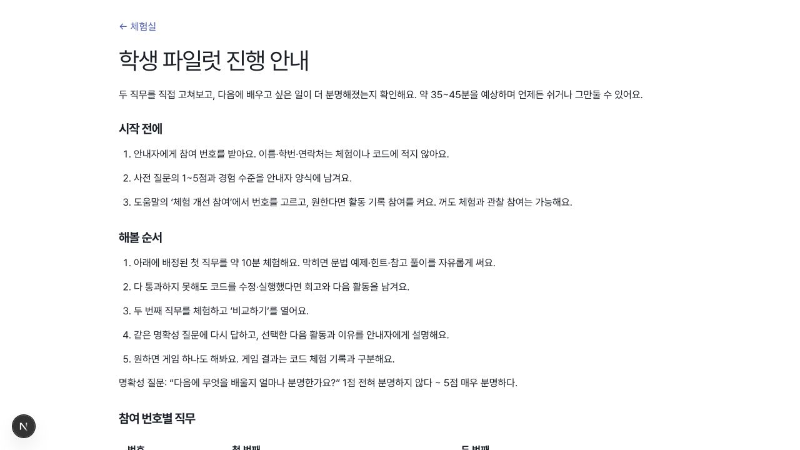

# 학생 파일럿 준비

이슈 #2 P1-5의 준비 자료입니다. **학생 모집·실험·후속 연락은 진행하지 않았고 성과 수치는 없습니다.** main 병합·배포 후 진행자가 QA 번호로 점검하고 사용합니다.

- 앱 안내: `/pilot`
- [진행안·모집 문구 초안·동의·관찰·사전/사후 질문·7일 확인·지표 분모](../public/pilot-kit/protocol.md)
- [12명 배정·사전/사후 빈 양식](../public/pilot-kit/participants.csv)
- [24개 직무 체험 관찰 빈 양식](../public/pilot-kit/observations.csv)
- [12명 7일 확인 빈 양식](../public/pilot-kit/followup.csv)
- [이벤트 계약·집계·보관 정책](ANALYTICS.md)

여섯 직무를 각 네 번, 첫째·둘째 순서로 각 두 번 배치합니다. 학생당 코드 두 직무를 체험하며 선택 게임은 별도 관찰합니다. 12명은 모집 목표이고 CSV의 번호·직무 배정 이외 응답은 모두 비어 있습니다. 35~45분은 안내용 예상입니다. PRD의 세 작업 방식이나 모든 직무 쌍을 비교하는 실험이 아닙니다.

관찰 참여·선택 분석·7일 후 연락 의사를 각각 확인합니다. 분석에 동의하지 않아도 체험할 수 있습니다. 7일 확인은 미완료자를 포함한 후속 연락 동의자 전체가 대상이며 자동 연락은 하지 않습니다. 사전·사후 동일 명확성 질문과 다음 행동/이유 설명은 진행자가 확인합니다. 무응답은 빈칸이며 ‘시작 안 함’으로 바꾸지 않습니다.

완성된 양식·연락처·동의 원본·학생 코드는 공개 저장소에 올리지 않습니다. 접근 제한 공간에 보관하고 종료·후속 확인 이후 30일 내 폐기합니다. 앱 이벤트도 동의 기간·보관 정책을 따릅니다. 작은 선택 표본의 결과를 실력·적성·전체 학생의 성과로 해석하지 않습니다.

템플릿은 다음 명령으로 재생성합니다. 실제 응답 파일을 이 경로에 덮어쓰지 않습니다.

```sh
node scripts/generate-pilot-kit.mjs
```


